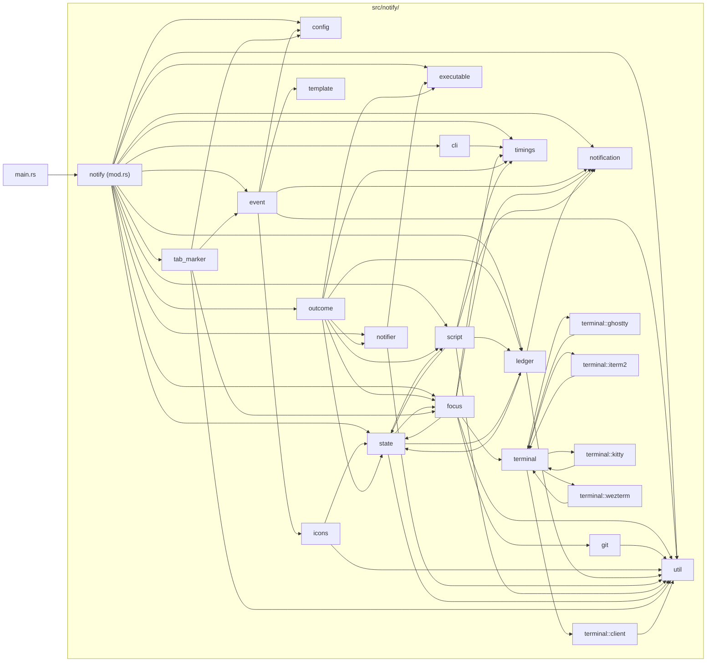
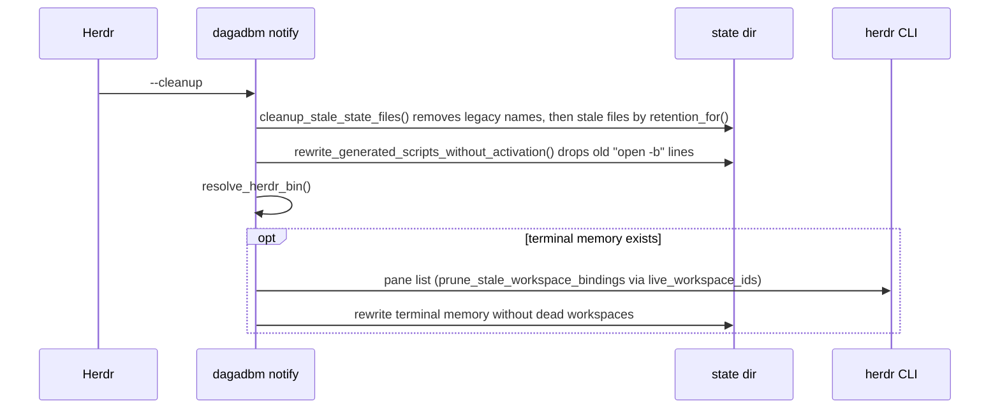
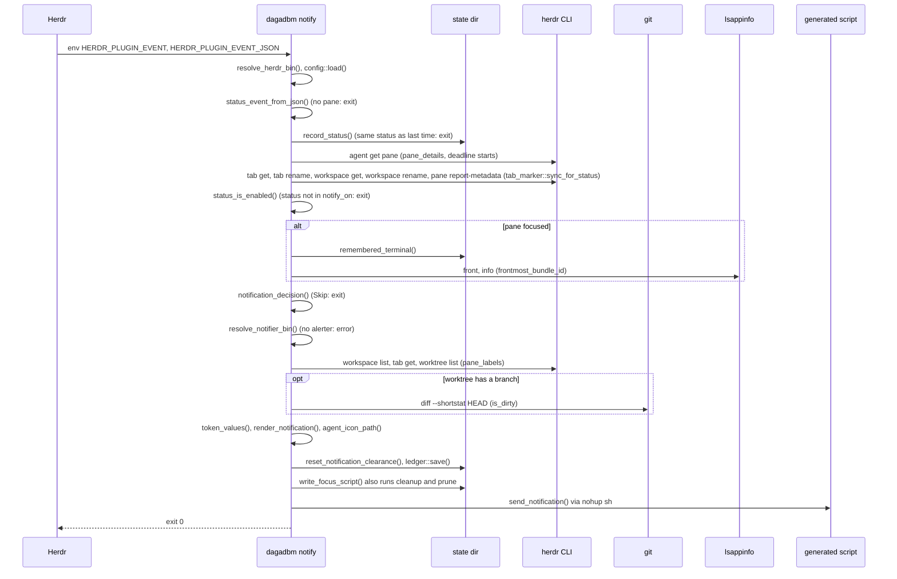
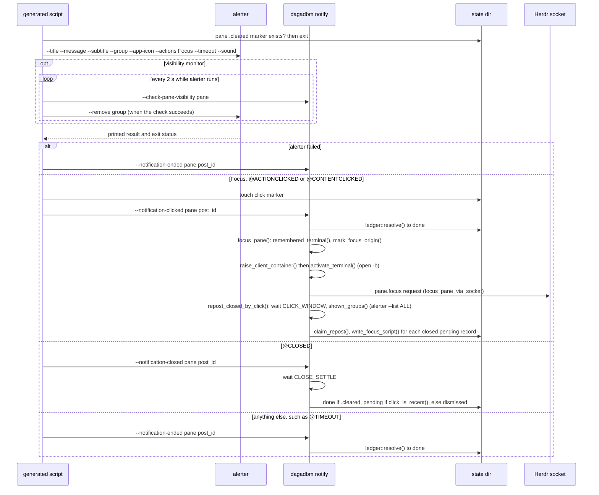
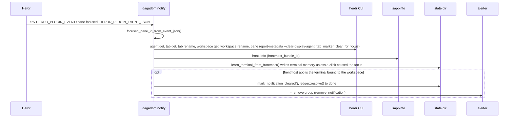
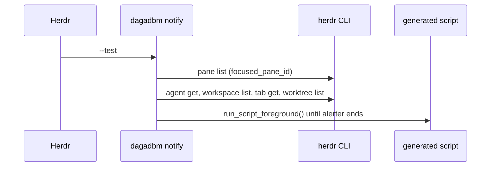
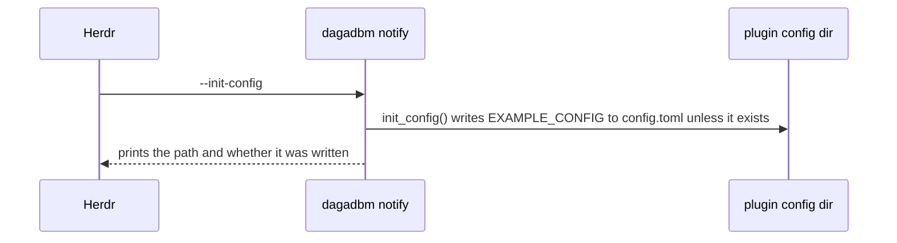
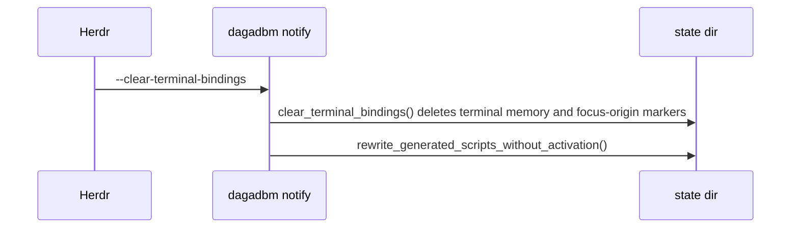

# Architecture

This document explains how herdr-dagadbm is built and why. Read it before you change code. Terms are defined in [glossary.md](glossary.md). Step-by-step recipes are in [dev-guidelines.md](dev-guidelines.md). Testing is in [test-guidelines.md](test-guidelines.md). Decisions and their history are in [adr/](adr/).

## Purpose

herdr-dagadbm is one Herdr plugin with the id `dagadbm` (`herdr-plugin.toml`). It is built as one Rust binary, also named `dagadbm` (`Cargo.toml`). The binary hosts small features and runs one of them per call: `dagadbm <feature> [args]` (`run` in `src/main.rs`, ADR 1).

There is one feature today, `notify` (`src/notify/`). It sends a clickable macOS notification through `alerter` when an agent pane needs the user, and focuses that pane when the notification is clicked (ADR 2, ADR 3). It also puts a marker icon in front of the tab label and the agent name (ADR 9), and it posts again a notification that alerter closed by mistake (ADR 12). It is a port of yankewei/herdr-focus-notify with configurable text (ADR 2).

The plugin runs only on macOS (`platforms` in `herdr-plugin.toml`, ADR 3).

## Process model

- **One short-lived process per hook.** Herdr runs `target/release/dagadbm` once per hook in `herdr-plugin.toml`, and the process exits when the hook is handled. There is no daemon. Herdr starts a new plugin process for each event, so anything that must survive between events lives in files in the state directory (ADR 10, see [Runtime state](#runtime-state)).
- **Dispatch.** `run` in `src/main.rs` reads the first argument. `notify` passes the rest to `run` in `src/notify/mod.rs`. `-h`/`--help` and `-V`/`--version` print to stdout. Anything else is an error. `main` prints an error as `dagadbm: <message>` on stderr and exits with a failure code. Herdr keeps stderr in the plugin log (ADR 4).
- **Feature arguments.** `parse_cli_args` in `src/notify/cli.rs` turns the arguments into one `CliAction`. No arguments means `CliAction::Event`. Two commands in one call are rejected.
- **Detached notification script.** A notification is shown by a shell script that `write_focus_script` in `src/notify/script.rs` writes into the state directory. `send_notification` in `src/notify/notifier.rs` starts it with `nohup sh ... &`, so it outlives the hook process. The script runs alerter, waits until alerter reports how the notification ended, then calls the binary again with `--notification-clicked`, `--notification-closed` or `--notification-ended`. The only exception is `--test`, which runs the script in the foreground (`run_script_foreground`).
- **Time budgets.** The Herdr and git lookups behind one notification share one deadline, `LOOKUP_BUDGET` (2 s) in `src/notify/mod.rs`. Marker clearing on focus has its own, `MARKER_BUDGET` (2 s) in `src/notify/tab_marker.rs`. Bounded commands run through `command_stdout_until` in `src/notify/util.rs`, which kills the child's whole process group at the deadline. The socket focus request waits at most `FOCUS_SOCKET_TIMEOUT` (5 s, `src/notify/focus.rs`). A terminal focus command waits at most `FOCUS_COMMAND_TIMEOUT` (2 s, `src/notify/terminal/mod.rs`).

### Entry points of `dagadbm notify`

| Arguments | `CliAction` | Called by | Handler |
| --- | --- | --- | --- |
| none | `Event` | Herdr events `pane.agent_status_changed` and `pane.focused` | `run` and `handle_pane_focused` in `src/notify/mod.rs` |
| `--test` | `Test` | action `notify-test` | `run` in `src/notify/mod.rs` |
| `--init-config` | `InitConfig` | action `notify-init-config` | `init_config` in `src/notify/config.rs` |
| `--cleanup` | `Cleanup` | `[[startup]]` hook | `cleanup_stale_state_files` in `src/notify/state.rs` |
| `--clear-terminal-bindings` | `ClearTerminalBindings` | action `notify-clear-terminal-bindings` | `clear_terminal_bindings` in `src/notify/state.rs` |
| `--check-pane-visibility <pane>` | `CheckPaneVisibility` | the visibility monitor in a generated script | `run` in `src/notify/mod.rs` |
| `--notification-clicked <pane> <post_id>` | `NotificationEnded` with `Outcome::Clicked` | a generated script | `clicked` in `src/notify/outcome.rs` |
| `--notification-closed <pane> <post_id>` | `NotificationEnded` with `Outcome::Closed` | a generated script | `closed` in `src/notify/outcome.rs` |
| `--notification-ended <pane> <post_id>` | `NotificationEnded` with `Outcome::Ended` | a generated script | `ended` in `src/notify/outcome.rs` |
| `--focus-pane <pane>` | `FocusPane` | scripts generated before ADR 12, and tests | `focus_pane` in `src/notify/focus.rs` |

`print_usage` in `src/notify/cli.rs` lists the no-argument form, `--test`, `--init-config`, `--cleanup`, `--clear-terminal-bindings` and `--help`. The other flags are internal: only generated scripts and tests call them.

## Module map

All code of `notify` lives in `src/notify/`. The source files that changed most often are `src/notify/event.rs` and `src/notify/config.rs` (see [Hotspots](#hotspots)).

| File | Responsibility | Main items |
| --- | --- | --- |
| `src/main.rs` | Picks the feature. | `run`, `USAGE` |
| `src/notify/mod.rs` | Orchestrates one call: the event path, the focus path and every `CliAction`. | `run`, `handle_pane_focused`, `LOOKUP_BUDGET` |
| `src/notify/cli.rs` | Parses arguments and prints help. | `parse_cli_args`, `CliAction`, `Outcome`, `print_usage` |
| `src/notify/config.rs` | Loads `[notify]` from the plugin config, with defaults. Writes the example config. | `load`, `parse`, `init_config`, `NotifyConfig`, `MarkerConfig`, `Templates`, `EXAMPLE_CONFIG`, `DEFAULT_TITLE` |
| `src/notify/event.rs` | Reads the event JSON. Builds token values and renders a notification. Holds the default state icons. | `status_event_from_json`, `focused_pane_id_from_event_json`, `StatusEvent`, `token_values`, `render_notification`, `state_icon`, `state_text` |
| `src/notify/template.rs` | The template renderer. | `TOKENS`, `TokenValues`, `render` |
| `src/notify/notification.rs` | Data types only. | `FocusNotification`, `PaneLabels` |
| `src/notify/focus.rs` | Herdr lookups about a pane, the skip and clear decisions, terminal learning, and the click-to-focus path. Despite its name it is also the Herdr query module. | `pane_details`, `pane_labels`, `tab_label`, `focused_pane_id`, `live_workspace_ids`, `notification_decision`, `should_clear_notification_on_focus`, `learn_terminal_from_frontmost`, `frontmost_bundle_id`, `focus_pane`, `focus_pane_via_socket`, `activate_terminal` |
| `src/notify/git.rs` | Whether the pane's directory has changes, for `{git_status}`. | `is_dirty` |
| `src/notify/state.rs` | The state directory and most files in it: terminal memory, focus-origin markers, cleared markers, last status, cleanup and the legacy-name migration. | `plugin_state_dir`, `remember_terminal`, `remembered_terminal`, `record_status`, `cleared_notification_marker_path`, `cleanup_stale_state_files`, `retention_for`, `remove_legacy_state_in` |
| `src/notify/ledger.rs` | The record of sent notifications, for re-posting (ADR 12). | `Record`, `Status`, `save`, `resolve`, `pending_records`, `claim_repost`, `click_marker_path`, `click_is_recent`, `CLICK_WINDOW` |
| `src/notify/outcome.rs` | What happens when a notification ends: click, close, or anything else. The re-post loop. | `clicked`, `closed`, `ended`, `repost_closed_by_click`, `CLOSE_SETTLE` |
| `src/notify/script.rs` | Writes the generated shell script that shows one posting. | `write_focus_script`, `alerter_focus_script`, `AlerterOptions`, `alerter_text_arg`, `test_timeout_secs`, `is_generated_script`, `rewrite_generated_scripts_without_activation` |
| `src/notify/notifier.rs` | Finds alerter and talks to it directly. | `resolve_notifier_bin`, `send_notification`, `remove_notification`, `shown_groups` |
| `src/notify/executable.rs` | Finds the `herdr` binary and executables in general. | `resolve_herdr_bin`, `find_executable` |
| `src/notify/icons.rs` | Maps an agent name to a bundled icon and writes it to disk for alerter. | `agent_icon_path`, `AGENT_ICONS`, `icon_for_agent` |
| `src/notify/tab_marker.rs` | Marks and unmarks the tab label, the workspace label and the pane's display agent (ADR 9). | `sync_for_status`, `clear_for_focus`, `SOURCE` |
| `src/notify/terminal/mod.rs` | Brings the terminal tab that runs Herdr forward before activation (ADR 11). | `TerminalAdapter`, `FocusCommand`, `ADAPTERS`, `raise_client_container` |
| `src/notify/terminal/client.rs` | Finds the Herdr clients of the session and reads their environment and directory. | `HerdrClient`, `herdr_clients`, `last_input`, `process_environment` |
| `src/notify/terminal/iterm2.rs`, `kitty.rs`, `wezterm.rs`, `ghostty.rs` | One adapter per terminal. | `Iterm2`, `Kitty`, `Wezterm`, `Ghostty` |
| `src/notify/util.rs` | Names, ids, quoting and command runners shared inside `notify`. | `PREFIX`, `prefixed`, `notification_group_id`, `is_notification_group_id`, `sanitize_group_id`, `workspace_of`, `command_stdout`, `command_stdout_until`, `shell_quote`, `hostname` |
| `src/notify/assets/icons/` | Agent icons, embedded into the binary with `include_bytes!` in `src/notify/icons.rs`. Their license is in `NOTICE.md`. | |

### Dependency graph

An edge `a --> b` means module `a` uses module `b` in non-test code. `docs/update.sh` generates this block from the source. Do not edit it by hand (see [dev-guidelines.md](dev-guidelines.md#refresh-the-dependency-graph)).

<!-- deps:start -->

<!-- deps:end -->

What the graph shows:

- `util` is the leaf that almost every module uses.
- `state` sits in three cycles: with `focus` (`live_workspace_ids` and `remembered_terminal`), with `script` (`is_generated_script` and `plugin_state_dir`) and with `ledger` (`is_ledger_file` and `plugin_state_dir`). A change to a file name or a retention rule usually touches `src/notify/state.rs` and the module that owns the file.
- The feature rule holds: nothing outside `src/notify/` is imported by `src/notify/`, and `src/shared/` does not exist yet (ADR 1). `docs/update.sh` prints any violation on stderr.

## Hook flows

Each diagram follows one hook in `herdr-plugin.toml` from Herdr to its outputs. `[[build]]` only runs `cargo build --release` and is not shown.

### `[[startup]]`: `dagadbm notify --cleanup`

### `[[events]] pane.agent_status_changed`: `dagadbm notify`

This is the main path, `run` in `src/notify/mod.rs`. The order matters, see [Invariants](#invariants). The marker calls run for every status change, before the `notify_on` check, because markers have their own `statuses` list (ADR 9). A status that does not notify still costs the `agent get` and the marker calls. The process exits with code 0 on every early exit.

### The generated script and its callbacks

`alerter_focus_script` in `src/notify/script.rs` builds the script. Its reports run `outcome.rs`.

What `repost_closed_by_click` in `src/notify/outcome.rs` does, in order:

1. It returns at once when no record of another pane is pending (`pending_records`).
2. It waits `CLICK_WINDOW` (1 s), then lists the shown groups with `shown_groups`. When the list fails, it posts nothing and the records stay pending.
3. For each pending record it skips the clicked pane, any record whose group is still shown, and any record posted less than `CLICK_WINDOW` before the list.
4. A record whose pane has a `.cleared` marker is set to done, not posted.
5. Each other record is claimed with `claim_repost`, which gives it a new `post_id`. The decision uses only the ledger status and alerter's list: a record is pending both while it is shown and after a collateral close, and the list tells the two apart. It does not wait for `closed` to have run. It is then posted by a new script, with the stored text, the stored timeout and no sound.

A re-post does not delete the `.cleared` marker. Only `run` does that, through `reset_notification_clearance`, before a new notification.

### `[[events]] pane.focused`: `dagadbm notify`

`run` sees `HERDR_PLUGIN_EVENT=pane.focused` and calls `handle_pane_focused` in `src/notify/mod.rs`.

### `[[actions]] notify-test`: `dagadbm notify --test`

The test runs the event path of `run` with these differences. The event is synthetic: the focused pane from `herdr pane list` (`focused_pane_id`), status `blocked`, agent `dagadbm test`. It skips `record_status` and the tab marker. It ignores `notify_on`. It never skips: a `Skip` decision becomes `Send`. The timeout is capped at 10 s by `test_timeout_secs` in `src/notify/script.rs`. The script runs in the foreground.

### `[[actions]] notify-init-config`: `dagadbm notify --init-config`

### `[[actions]] notify-clear-terminal-bindings`: `dagadbm notify --clear-terminal-bindings`

## Runtime state

All files live in the state directory: `$HERDR_PLUGIN_STATE_DIR`, or `<temp dir>/herdr-dagadbm-notify` when Herdr does not set it (`plugin_state_dir` in `src/notify/state.rs`, ADR 13). `<pane>` is the pane id passed through `sanitize_group_id` in `src/notify/util.rs`, so `w1:p3` becomes `w1-p3`. Every name is built from `PREFIX` in `src/notify/util.rs`. Most names use a dash after the prefix. The ledger files use dots instead, because they form a namespace: prefix, then `repost`, then the kind (ADR 13, `namespace` in `src/notify/ledger.rs`). Retention is applied by `retention_for` in `src/notify/state.rs`: 24 h is `TEMP_FILE_RETENTION`, 30 days is `GENERATED_SCRIPT_RETENTION`, 15 s is `FOCUS_ORIGIN_RETENTION`.

| Name | Holds | Written by | Read by | Removed |
| --- | --- | --- | --- | --- |
| `herdr-dagadbm-notify-terminal-memory.json` | Workspace id to terminal bundle id (`{"workspaces": {...}}`). | `remember_terminal`, `prune_stale_workspace_bindings` (`src/notify/state.rs`) | `remembered_terminal` | `clear_terminal_bindings`. Never by age. |
| `herdr-dagadbm-notify-focus-origin-<workspace>.marker` | That a click is focusing a pane in this workspace. | `mark_focus_origin`, from `focus_pane` | `focus_origin_is_active` | After 15 s (`FOCUS_ORIGIN_RETENTION`), on a failed focus (`clear_focus_origin`), or by `clear_terminal_bindings`. |
| `herdr-dagadbm-notify-<pane>.cleared` | That the user saw the pane, so its notification is over. | `mark_notification_cleared`, from `handle_pane_focused` | The generated script, `closed` and `repost_closed_by_click` (`src/notify/outcome.rs`) | `reset_notification_clearance` before each send. After 24 h. |
| `herdr-dagadbm-notify-<pane>.cleared.result.XXXXXX`, `.cleared.status.XXXXXX` | alerter's output and exit status, while the script runs. | `mktemp` in the generated script | The generated script | The script's `trap`. After 24 h. |
| `herdr-dagadbm-notify-<pane>.last-status` | The pane's last agent status (ADR 10). | `record_status` | `record_status` | After 24 h. |
| `herdr-dagadbm-notify-focus-<hash>.sh` | The generated script of one pane. `<hash>` is the pane id hashed with `DefaultHasher`. | `write_focus_script` (through a `.<pid>.tmp` file and a rename) | `sh` | After 30 days (`GENERATED_SCRIPT_RETENTION`). |
| `herdr-dagadbm-notify-icons/` | Agent PNGs written from the binary. | `write_embedded_icon_into` in `src/notify/icons.rs` | alerter `--app-icon` | Never. |
| `herdr-dagadbm-notify.repost.record.<pane>.json` | The ledger `Record` of the pane's latest notification (ADR 12). | `save`, `resolve`, `claim_repost` in `src/notify/ledger.rs` | `pending_records` | After 24 h. |
| `herdr-dagadbm-notify.repost.claim.<pane>.<post_id>` | That one click took the right to re-post this posting. `<post_id>` is the posting being replaced, not the new one. | `claim_repost_in` | `claim_repost_in` (`create_new` fails if it exists) | After 24 h. |
| `herdr-dagadbm-notify.repost.click` | The time of the last click, as its modification time. | The generated script (`touch`) | `click_is_recent` | After 24 h. |

State outside the state directory:

- **Alerter group** `herdr-dagadbm-notify-<pane>` (`notification_group_id` in `src/notify/util.rs`). One per pane, so a new notification replaces the pane's old one on screen.
- **Plugin config** `$HERDR_PLUGIN_CONFIG_DIR/config.toml` (`config_path` in `src/notify/config.rs`, ADR 4). Read on every call. Written only by `init_config`.
- **Herdr tab and workspace labels** carry the tab and workspace markers, and **the pane's display agent**, reported with `--source dagadbm` (`SOURCE` in `src/notify/tab_marker.rs`), carries the agent marker (ADR 9). The marker text is the only record of the mark.

Files with names from before ADR 13 (`herdr-<pane>.*`, `focus-<hash>.sh`, `focus-origin-<workspace>.marker`, the `icons` folder) are deleted, and the old `terminal-memory.json` is renamed, by `remove_legacy_state_in` in `src/notify/state.rs`.

Cleanup runs in two places: on the `--cleanup` startup hook, and at the start of every `write_focus_script` call, that is on every send and every re-post (`src/notify/script.rs`). Both are best-effort.

## External process boundaries

Every external call is made through `std::process::Command` or a Unix socket. Tests replace these tools with stubs on `PATH` (see [test-guidelines.md](test-guidelines.md)).

| Tool | How it is found | Calls | Bounded | Code |
| --- | --- | --- | --- | --- |
| `herdr` CLI | `HERDR_BIN_PATH` (an error if set but not executable, even before any event is read), else `PATH`, `~/.local/bin`, `/opt/homebrew/bin`, `/usr/local/bin`, else the bare name. This order differs from alerter's, and no ADR explains it. | `agent get`, `tab get`, `tab rename`, `workspace get`, `workspace rename`, `workspace list`, `worktree list --cwd`, `pane report-metadata` | Yes, `command_stdout_until` | `resolve_herdr_bin` in `src/notify/executable.rs`; `pane_details`, `pane_labels`, `tab_label` in `src/notify/focus.rs`; `src/notify/tab_marker.rs` |
| `herdr` CLI | as above | `pane list` | No, `command_stdout` | `focused_pane_id`, `live_workspace_ids` in `src/notify/focus.rs` |
| Herdr socket | `HERDR_SOCKET_PATH` | One JSON line, method `pane.focus`, id `dagadbm:focus` | 5 s read timeout | `focus_pane_via_socket` in `src/notify/focus.rs` |
| `alerter` | `PATH`, then `/opt/homebrew/bin`, `/usr/local/bin`, `~/.local/bin` (ADR 3) | Post (from the script), `--remove <group>`, `--list ALL` | No | `resolve_notifier_bin`, `remove_notification`, `shown_groups` in `src/notify/notifier.rs`; `alerter_focus_script` in `src/notify/script.rs` |
| `git` | `PATH` | `--no-optional-locks -C <cwd> diff --shortstat HEAD` with `LC_ALL=C` | Yes | `is_dirty` in `src/notify/git.rs` |
| `lsappinfo` | `PATH` | `front`, then `info -only bundleID <asn>` | No | `frontmost_bundle_id` in `src/notify/focus.rs` |
| `open` | `PATH`; `/usr/bin/open` for iTerm2 | `-b <bundle id>`; `iterm2:reveal?sessionid=...` | No; the adapter call is 2 s | `activate_terminal` in `src/notify/focus.rs`; `src/notify/terminal/iterm2.rs` |
| `lsof`, `ps` | `PATH` | Client sockets and working directories; a client's tty | No | `herdr_clients`, `process_cwd`, `controlling_tty` in `src/notify/terminal/client.rs` |
| `kitten`, `wezterm`, `osascript` | From the client's environment, or `/usr/bin/osascript` | Focus one terminal container | 2 s | `src/notify/terminal/kitty.rs`, `wezterm.rs`, `ghostty.rs` |
| `hostname` | `PATH` | `-s` | No | `hostname` in `src/notify/util.rs` |
| `sh`, `nohup` | `PATH` | Run the generated script | No | `send_notification` in `src/notify/notifier.rs` |
| libc | linked | `sysctl(KERN_PROCARGS2)` for a client's environment; `kill` of a process group | n/a | `process_environment` in `src/notify/terminal/client.rs`; `kill_process_group` in `src/notify/util.rs` |

Environment variables the binary reads: `HERDR_PLUGIN_EVENT`, `HERDR_PLUGIN_EVENT_JSON` (`run` in `src/notify/mod.rs`), `HERDR_BIN_PATH` (`resolve_herdr_bin`), `HERDR_PLUGIN_CONFIG_DIR` (`config_path`), `HERDR_PLUGIN_STATE_DIR` (`plugin_state_dir`), `HERDR_SOCKET_PATH` (`focus_pane`), `HERDR_CLIENT_SOCKET_PATH` (`herdr_clients`), `HOME` (`home_dir` in `src/notify/executable.rs`), `PATH`.

## Invariants

Each rule below says what must hold, why, and where it is enforced. Break one only together with a new or updated ADR.

1. **A feature imports only its own code and `src/shared/`.** Why: a feature can be removed by deleting its folder and its manifest entries (ADR 1). Checked by `docs/update.sh`.
2. **Every runtime name a feature creates starts with `herdr-dagadbm-<feature>`.** Why: a file in the shared state directory shows its owner, and features cannot collide (ADR 13). In `notify`, every name comes from `PREFIX` through `prefixed`, `notification_group_id` (`src/notify/util.rs`) or `namespace` (`src/notify/ledger.rs`).
3. **Settings live only in `$HERDR_PLUGIN_CONFIG_DIR/config.toml`.** Why: Herdr's own `config.toml` rejects unknown keys (ADR 4). Every key is optional, unknown keys are ignored, and a file that cannot be parsed is reported on stderr while the defaults apply (`load` in `src/notify/config.rs`). The file is read on every call, so nothing caches config.
4. **`config.example.toml` lists every key with its default.** Why: `init_config` writes it as the user's starting file (`EXAMPLE_CONFIG`, ADR 4). The test `the_example_config_parses_to_the_defaults` in `src/notify/config.rs` checks part of this (see [Known discrepancies](#known-discrepancies)).
5. **Templates use only Herdr's token names and render exactly as written.** A missing value renders empty. An unknown `{token}` stays as written. Nothing around an empty token is cleaned up. Why: users already know Herdr's syntax, and the config should match the output (ADR 5, ADR 6). Enforced by `TOKENS` and `render` in `src/notify/template.rs`.
6. **alerter gets a non-empty message and text in `--option=value` form.** An empty message is sent as one space, and a whitespace-only subtitle is left out. Why: alerter refuses an empty `--message` (ADR 3, ADR 6), and a text that starts with `-` would be read as an option (`alerter_text_arg` in `src/notify/script.rs`).
7. **A repeated status is skipped before any Herdr call, and the status is saved before the markers write.** Why: the agent marker's write makes Herdr send the same status again, which would notify twice (ADR 10). Enforced by the order in `run` in `src/notify/mod.rs`: `record_status` comes before `pane_details` and `sync_for_status`.
8. **One `agent get` serves both the skip decision and the text, and the skip comes before the text lookups.** Why: a suppressed notification must not pay for the other lookups (comment in `run`, `src/notify/mod.rs`).
9. **Lookups are best-effort.** An unanswered `agent get` counts as an unfocused pane, so the notification is sent. An unanswered label renders as an empty token (`PaneDetails` in `src/notify/focus.rs`, `PaneLabels` in `src/notify/notification.rs`).
10. **Herdr's reply must be about the pane that was asked about.** Why: a stale snapshot would name another pane on a notification that focuses this one (`pane_details_from_get_json` in `src/notify/focus.rs`).
11. **The tab and workspace labels are read before the markers change them, and the notification shows them without the marker.** (`sync_for_status` in `src/notify/tab_marker.rs` returns them as `OriginalLabels`, which `run` passes to `pane_labels`.)
12. **Markers store nothing.** A label that starts with the icon and a space is marked. A focused pane is never marked. A tab or workspace the user renamed is left alone (ADR 9, `marked_label` and `unmarked_label` in `src/notify/tab_marker.rs`).
13. **A report from an old posting changes nothing.** Why: a script can outlive its posting when a newer notification replaces it (ADR 12, `resolve_in` in `src/notify/ledger.rs` compares `post_id`).
14. **A click stamps the click marker before it reports, and a close waits `CLOSE_SETTLE` before it reads the marker. A close that cannot be told apart counts as the user's.** Why: alerter 26.5 closes another notification on a click, and only timing tells the two apart (ADR 12, `alerter_focus_script` in `src/notify/script.rs`, `closed` in `src/notify/outcome.rs`).
15. **A posting is re-posted at most once.** Why: two clicks at the same time must not show it twice (ADR 12). The claim file is created with `create_new` in `claim_repost_in` in `src/notify/ledger.rs`.
16. **Files that other processes read are written to a temp file and renamed into place.** This covers ledger records (`save_in`), terminal memory (`remember_bindings_into`), scripts (`write_focus_script`) and icons (`write_embedded_icon_into`). Why: concurrent hook processes, and `sh` reads a script while it runs, so a rename keeps the running copy intact (comment in `write_focus_script`).
17. **A click does not teach the terminal binding.** Why: the app that was frontmost when the user clicked a notification is not the terminal. `focus_pane` writes a focus-origin marker that `learn_terminal_from_frontmost` honours for 15 s. Obvious non-terminal apps are rejected too (`is_obvious_non_terminal_bundle` in `src/notify/state.rs`).
18. **A notification is removed on focus only when the frontmost app is the terminal bound to the workspace.** Why: the user only sees the pane then (`should_clear_notification_on_focus` in `src/notify/focus.rs`).
19. **Terminal bindings are never pruned against an empty pane list.** Why: right after Herdr starts it may report no panes (`live_workspace_ids` in `src/notify/focus.rs`).
20. **A terminal adapter returns no command when it cannot be sure, and any failure falls back to `open -b`.** Why: a wrong but successful command stops the core from trying the next client (ADR 11, `raise_client_container` in `src/notify/terminal/mod.rs`).
21. **A bounded command leaves nothing running.** Why: a git or herdr descendant left behind would keep working in the pane's repository (`command_stdout_until` and `kill_process_group` in `src/notify/util.rs`). git also runs with `--no-optional-locks` so it never takes `.git/index.lock` while an agent uses git (`is_dirty` in `src/notify/git.rs`).

## Where to change X

| To change | Edit | Then |
| --- | --- | --- |
| A notification default (title, subtitle, message, statuses, sound, timeout) | `DEFAULT_*` in `src/notify/config.rs`, `config.example.toml`, `README.md`, ADR 7 | Update tests in `src/notify/event.rs`, `src/notify/config.rs` and `tests/notify_cli_test.rs` that assert the old text. Recipe: [dev-guidelines.md](dev-guidelines.md#change-a-default). |
| A default state icon | `state_icon` in `src/notify/event.rs` and `[notify.state_icons]` in `config.example.toml` | ADR 5 and ADR 7 list the glyphs. |
| Which statuses notify by default | `DEFAULT_STATUSES` in `src/notify/config.rs` | |
| A new config key | `src/notify/config.rs` and `config.example.toml` | [dev-guidelines.md](dev-guidelines.md#add-a-config-key) |
| A new template token | `TOKENS` in `src/notify/template.rs`, `token_values` in `src/notify/event.rs` | Only tokens Herdr defines (ADR 5). [dev-guidelines.md](dev-guidelines.md#add-a-template-token) |
| How the event JSON is read | `EventData` and `status_event_from_json` in `src/notify/event.rs` | |
| Which Herdr lookups feed the text | `pane_labels` in `src/notify/focus.rs` | Keep them under `LOOKUP_BUDGET`. |
| When a notification is skipped | `notification_decision` in `src/notify/focus.rs` | |
| alerter arguments or the script | `alerter_focus_script` in `src/notify/script.rs` | Existing scripts keep the old text until rewritten. |
| What a click, close or timeout does | `src/notify/outcome.rs`, `src/notify/ledger.rs` | ADR 12 |
| Tab, workspace and agent markers | `src/notify/tab_marker.rs`, `MarkerConfig` in `src/notify/config.rs` | ADR 9 |
| Terminal tab selection on click | `src/notify/terminal/` | [dev-guidelines.md](dev-guidelines.md#add-a-terminal-adapter) |
| Agent icons | `AGENT_ICONS` in `src/notify/icons.rs` and `src/notify/assets/icons/agents/` | Update `NOTICE.md` for the license. |
| A state file name or its retention | The owning module and `retention_for` in `src/notify/state.rs` | Rename old files in `remove_legacy_state_in` (ADR 13). |
| The alerter or herdr search paths | `alerter_candidate_paths` in `src/notify/notifier.rs`, `herdr_candidate_paths` in `src/notify/executable.rs` | ADR 3 |
| A hook or action | `herdr-plugin.toml`, `parse_cli_args` in `src/notify/cli.rs`, `run` in `src/notify/mod.rs` | [dev-guidelines.md](dev-guidelines.md#add-a-hook-or-action) |
| A new feature | Follow the ordered recipe | [dev-guidelines.md](dev-guidelines.md#add-a-feature) |

## Hotspots

`git log --stat` shows which files change together. The counts below are as of commit `4b1d73b`, out of 11 commits. Recount with `git log --name-only --pretty=format: | sort | uniq -c | sort -rn`. The hotspots are:

- **`tests/notify_cli_test.rs`** (8 of 11 commits). Every behaviour change adds or edits an integration test here. It is 2000 lines long. Find a test by its function name, and reuse the `Session` helper for anything that involves clicks or closes (see [test-guidelines.md](test-guidelines.md)).
- **`src/notify/config.rs`, `src/notify/event.rs`, `config.example.toml`, README and ADR 7** (7 commits each). Four commits only changed a default template. Each touched all five files plus test expectations, because the default lives in `DEFAULT_*` constants, in the example file, in the README, in ADR 7, and in test assertions.
- **`src/notify/mod.rs`** (4 commits). New steps are added to `run`, and their position in it carries meaning (invariants 7, 8 and 11).
- **`src/notify/state.rs`, `src/notify/focus.rs`** (3 commits each). `focus.rs` is the largest source file and `state.rs` the third largest. `state.rs` owns most file names and the cleanup rules. `focus.rs` mixes Herdr queries, decisions and the click path.

## Known discrepancies

These are places where the code, the ADRs, the project rules and the config disagree. They are listed here, not resolved.

1. **The config parity test is partial.** The project rule (invariant 4) is that `config.example.toml` matches the defaults and that a test enforces it. `the_example_config_parses_to_the_defaults` in `src/notify/config.rs` compares statuses, templates, sound, timeout and both markers. It does not compare `[notify.state_icons]`: those defaults live in `state_icon` in `src/notify/event.rs`, and `NotifyConfig::default()` has none. It also cannot notice a key that the example sets but the code does not read, because unknown keys are ignored.
2. **One integration test runs the real `lsappinfo`.** `blocked_agent_marks_tab_and_agent_name_and_working_or_focus_restores_them` has no `lsappinfo` stub for its `pane.focused` step. This is accepted, because `lsappinfo` only reads. Tests that need Herdr use the isolated test server (ADR 14, [test-guidelines.md](test-guidelines.md#the-test-herdr-server)).
3. **Unit tests use the real fallback state directory.** `agent_icon_path` writes icons to `plugin_state_dir()`, which is `$HERDR_PLUGIN_STATE_DIR` or `<temp dir>/herdr-dagadbm-notify`, the directory the plugin itself uses. This happens in the tests of `src/notify/icons.rs` and in `renders_the_default_layout_from_herdr_labels` in `src/notify/event.rs`. The script tests in `src/notify/script.rs` read the real terminal memory through `remembered_terminal`.
4. **The lookup budget is not the whole cost.** The comment on `LOOKUP_BUDGET` in `src/notify/mod.rs` says a slow Herdr costs at most that delay. But `write_focus_script` calls `prune_stale_workspace_bindings`, which runs an unbounded `herdr pane list` on every send when terminal memory exists. `frontmost_bundle_id` (`lsappinfo`), `hostname` and `remove_notification` are unbounded too.
5. **ADRs 10, 12 and 13 call it "startup cleanup".** Cleanup also runs on every send and re-post, inside `write_focus_script` in `src/notify/script.rs`.
6. **The naming rule has edges it does not cover.** ADR 13 says every file and folder a feature creates starts with its sub-plugin name. The icon folder does, but the files inside it (`codex-color.png` and the temp `.codex-color.png-<pid>-<seq>`) do not (`write_embedded_icon_into` in `src/notify/icons.rs`). The Herdr metadata source is `dagadbm` (`SOURCE` in `src/notify/tab_marker.rs`, as ADR 9 specifies), and the socket request id is `dagadbm:focus`. Neither is a file, so ADR 13 does not decide them.
7. **Some leftovers are never cleaned.** `retention_for` in `src/notify/state.rs` returns no retention for a script temp file (`herdr-dagadbm-notify-focus-<hash>.<pid>.tmp`), the terminal-memory temp file, or the icons folder. They only stay behind after a crash between write and rename.
